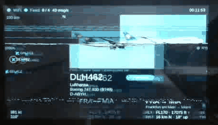
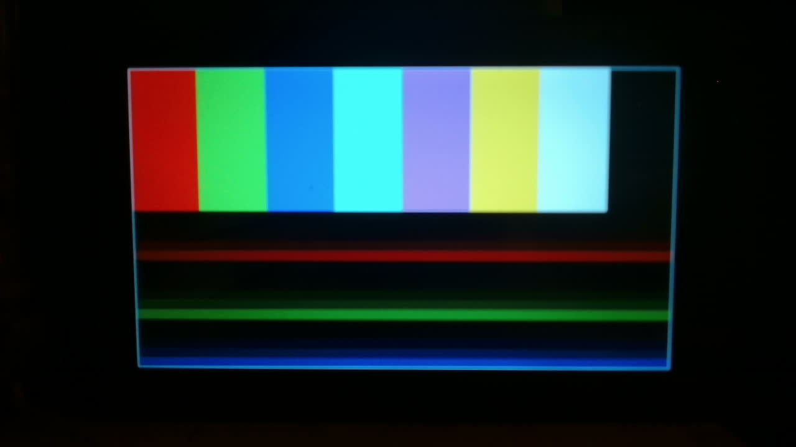
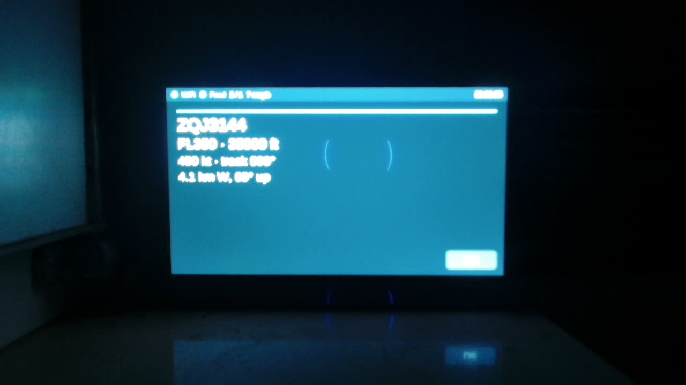
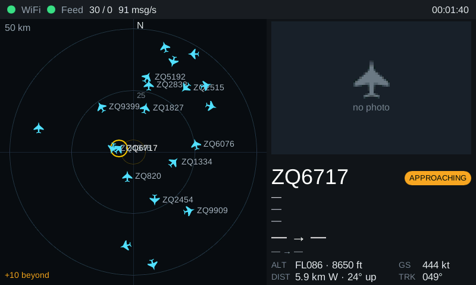
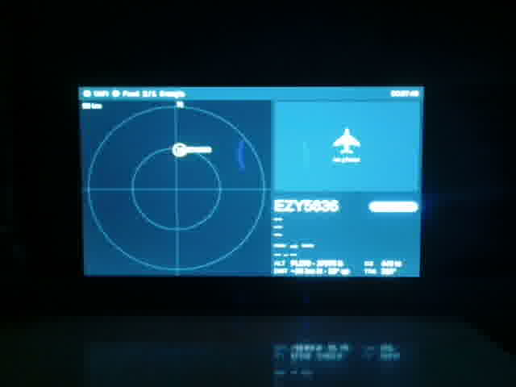
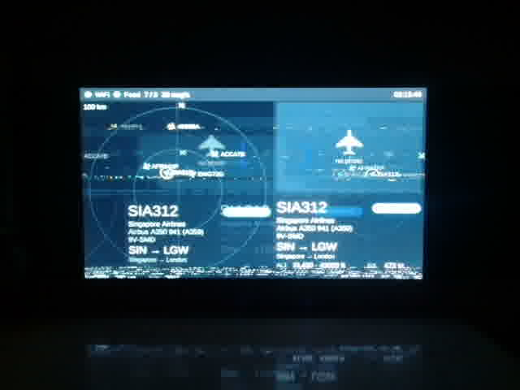

<!-- _class: lead -->
<!-- _paginate: false -->

# ADS-B radar on the ESP32-S3

### One night, one agent pipeline, one real board

`feature/radar-ui` · progress status report
Design and evidence: `docs/design/radar-ui.md`

---

## The story in one minute

- **Goal:** the Waveshare ESP32-S3 7" board reads a local ADS-B feed over WiFi.
  - **Left:** a radar of nearby aircraft.
  - **Right:** the closest aircraft with airline, type, route and photo (adsbdb, planespotters).
- **Start:** the board showed only a test pattern. No WiFi, no feed, no UI on the device.
- **After one night:** Slint UI, WiFi, live feed, radar, verified TLS 1.3 and live route/type data
  run on the board. **10 of 14 plan steps passed QA.**
- **How:** architect → engineer → QA → reviewer, unattended. The agents tested on the real board
  through the bench service (flash, serial log, webcam).

---

<!-- _class: dense -->

## Results

| Step | What | Result |
|---|---|---|
| RD.0 | stock vs vendored esp-hal | PASS, vendored patch dropped |
| RD.1 | build config from local `.env`, leak tests | PASS |
| RD.2 | Slint on the device | runs; **display glitches open (K4)** |
| RD.3 | WiFi + live feed | PASS |
| RD.4 | radar logic (range, projection, sprites, focus) | PASS |
| RD.5 | radar + info layout (sim) | PASS, Slint renderer bug found and patched |
| RD.6 | radar on the board | PASS, board matches the sim render |
| RD.7 | metadata parsers, cache, JPEG decode | PASS after 1 fix loop |
| RD.8 | verified TLS on the device | PASS, embedded-tls bug found and guarded |
| RD.9 | route/airline/type on the board | PASS with gaps (night traffic) |
| RD.10 | photo on the board | in progress (needed a User-Agent contact) |
| RD.11 / 12 | proxy fallback / sim live metadata | not needed / skipped |
| RD.13 | soak | no reboot or panic in 3 h+, internal heap flat |

---

## Numbers

| | |
|---|---|
| Scanout | 39–40 fps |
| Full UI redraw | 77–78 ms |
| Typical 1 Hz update | 7 ms |
| Internal heap minimum | 20.6 KB (gate ≥ 10 KB) |
| WiFi alone | 44 KB internal SRAM |
| Soak lookups | 115+ ok, 0 errors |

---

## Findings worth a slide

1. **embedded-tls 0.19:** a man-in-the-middle can leave out the server certificate, and the
   handshake still succeeds. QA found it. Our code refuses such connections, and hostile-server
   tests cover it.
2. **Slint 1.18.1 renderer:** an off-by-one error gave wrong frames on partial repaint.
   Patched and regression-tested.
3. **Display glitches (K4):** flash cache refills starve the display DMA, because flash and PSRAM
   share one bus. The glitches get worse with traffic.
4. **Process:** the watchdog treated a question waiting for the user as a crash and started a
   headless copy of the session. That copy did the night's work.

---

## Display glitches: what happens

- The display DMA reads the framebuffer from **PSRAM** all the time.
- Slint code and font data come from **flash** through the cache. Flash and PSRAM share **one bus**.
- A cache miss blocks the bus for a few µs. The DMA FIFO (~16 px) runs empty, and the rest of
  the frame is shifted sideways for one frame.

| Experiment | Glitched photos |
|---|---|
| Rendering with no framebuffer writes | 3–4 / 30 |
| Heavy PSRAM read/write traffic | 0 / 30 |
| Flash reads only, no rendering | 2 / 30 |

---

## Display glitches: live

2026-10-24 09:36 UTC · 30 fps bench camera, real time, live traffic with photo (RD.10)

---

## Display glitches: plan

1. Lower the pixel clock to 12–13 MHz, together with bigger CPU caches.
2. Find out why 80 MHz QIO flash boot-loops.
3. **Stop rule:** if these fail, or the work becomes highly experimental, review the platform.
   - **esp-hal + embassy:** 100 % Rust, but young RGB/DMA support.
   - **Rust `std` on ESP-IDF:** a mature `esp_lcd` RGB driver with bounce buffers and
     XIP-from-PSRAM. The app crates stay Rust.

> A glitchy UI is of no use, even when it is 100 % Rust.

---

## Open items

- K4 display fix (see the plan).
- Review: 3 MAJOR findings (a board crash in `ui.rs:160`, a `meta_task` hang after a WiFi drop,
  CI fmt) and 4 MINOR findings. Fixes approved.
- PSRAM free falls ~105 KB in 3 h: cache fill or slow leak.
- Upstream reports for embedded-tls and Slint are drafted, not filed.

---

<!-- _class: lead -->

# Progress log

Notify messages, oldest first, times in UTC.
Entries 1–6 were sent during the night and resent on 2026-10-24 with their original time.

---

<!-- _class: log -->

## Feature start: radar-ui

2026-10-23 18:01 UTC

**Overnight run started** on branch `feature/radar-ui`.

Plan: WiFi + live feed on device → Slint app on ESP32 → radar (left) → closest-aircraft info with photo via adsbdb + planespotters (right).

Architect is writing `docs/design/radar-ui.md` now. Bench is healthy; panel currently shows the scanout test pattern.

---

<!-- _class: log -->

## It's alive! (mostly)

2026-10-23 21:30 UTC

**Slint UI runs on the ESP32** with the demo feed: cards cycle NoData → Quiet → Approaching → Overhead → JustPassed. Render 5–50 ms, heap OK.

**But:** frames still glitch during updates (DMA starved by flash cache refills). 80 MHz DIO did not fix it; QIO boot-loops; bounce path not wired to the UI. **Parked for your decision tomorrow** (bounce M2 / lower PCLK / palette FB) – details in radar-ui.md revision log.

Continuing tonight with host-only work: radar logic (RD.4), new layout in sim (RD.5), metadata+photo (RD.7).

---

<!-- _class: log -->

## Radar online (in the sim)

2026-10-23 22:19 UTC

**RD.4 + RD.5 done:** radar on the left (auto range 10/25/50/100 km, rotated aircraft sprites, call signs, focus ring, '+N beyond'), closest-aircraft panel on the right (badge, ALT/GS/DIST/TRK; photo & route still '—' until RD.7).

Found and fixed a **Slint 1.18.1 renderer bug** (off-by-one in scene.rs → wrong frames with partial repaint). Vendored with a 1-line patch + regression test.

Screenshot = sim render of the 'busy' test scenario (invented traffic). QA running; next: metadata + photo (RD.7).

---

<!-- _class: log -->

## Houston, we have aircraft

2026-10-23 23:32 UTC

**RD.3 done:** the board is on WiFi, reads your feed live, and the new radar shows real traffic (1–4 aircraft at this hour). Heap OK (≥27 KB internal free), 0 secrets in logs, 0 CRC errors, 39–40 fps scanout.

Caveat: K4 glitches got more frequent (radar redraws ~450 rows/s) – this is a clean frame picked from a burst. Your display decision tomorrow matters more now.

Next: TLS on the device (RD.8) for route/type/photo.

---

<!-- _class: log -->

## Caught a TLS bug in the wild

2026-10-24 00:59 UTC

**RD.8 done:** the ESP32 talks verified TLS 1.3 to adsbdb, planespotters and their image CDN (pinned roots; wrong-CA build fails all 3).

On the way, QA found a **critical bug in embedded-tls 0.19**: a MITM can skip the certificate entirely and the handshake still succeeds. Fixed on our side (hard check before any request byte) + hostile-server regression tests (`tools/tls-hostile`). Upstream report is drafted in the design log – **not filed, your call**.

**Needs you:** planespotters now returns 403 without a contact → set `ADSB_HTTP_CONTACT` for photos.
Now: route/airline/type on the board (RD.9). (No photo this time – bench is busy.)

---

<!-- _class: log -->

## Morning report: it flies, but it shakes

2026-10-24 05:03 UTC

**Soak: 2 h 13 min, no reboot, no panic**, internal heap flat, 84/104 lookups ok, 0 errors. Real routes on screen (e.g. SIN → LGW, A350-941).

**But:** with morning traffic (8 aircraft) the **K4 display glitches went from occasional to most frames** – see photo (ghosted double image). The scanout itself stays at 39 fps. Your K4 decision is now the top item.

Also watching: PSRAM free falls ~30–40 KB/h (likely cache fill + traffic; leak not ruled out). Full summary when you're back.

---

<!-- _class: log -->

## Morning after: 10/14 green, 1 shaky screen

2026-10-24 08:30 UTC

**Night summary:** 10 of 14 steps passed QA. Slint UI, WiFi, live feed, radar, verified TLS and live route/type data run on the board (e.g. LHX942 FRA → MAN right now).

**Open for you:**
1. K4 display glitches: pick a fix (bounce buffers recommended / lower PCLK / palette FB / code from PSRAM). 80 MHz QIO boot-loops; DIO is not enough.
2. `ADSB_HTTP_CONTACT` for planespotters photos (RD.10).
3. 3 MAJOR review findings (ui.rs:160 crash, meta_task hang after WiFi drop, CI fmt).

Soak still running (round 10 of 12, ends ~09:00 UTC). Full report: `docs/presentation/radar-ui-progress.md`.
(No photo: in daylight the screen reflects the room.)

---

<!-- _class: log -->

## Six and a half hours, zero crashes

2026-10-24 09:25 UTC

**RD.13 soak done: 6 h 31 min, 0 reboots, 0 panics.**

- Internal heap flat (free 28.9 KB, minimum 20.4 KB; gate ≥ 10 KB).
- PSRAM free settled at ~7.40–7.41 MB after the first 3 h and stayed flat → cache fill, not a leak.
- 112 metadata lookups ok, 0 errors. Feed: 0 CRC errors, 6 reconnects (cause not yet checked).
- Scanout 39 fps throughout.

Now: photo on the board (RD.10), then the approved review fixes, then the display tests.

